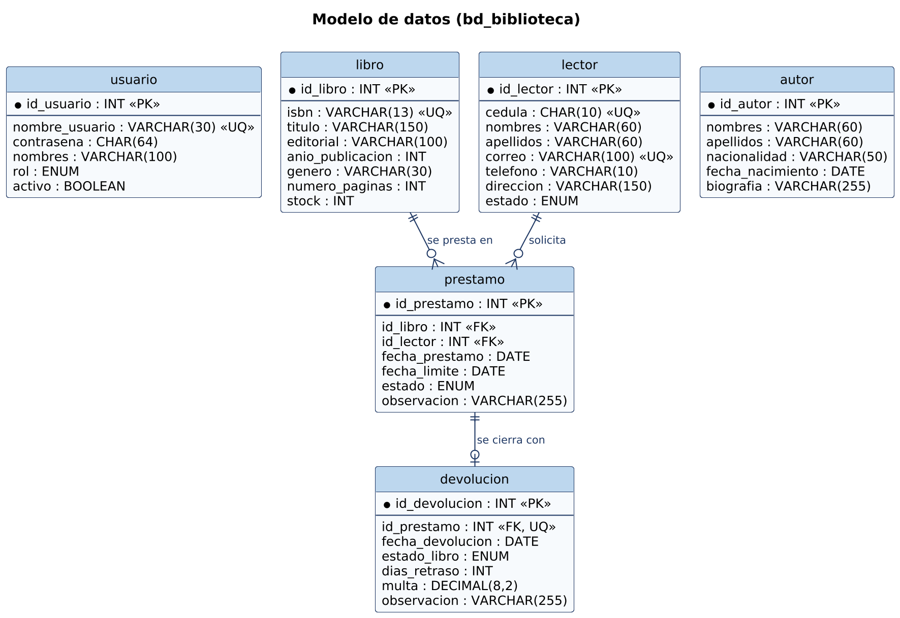
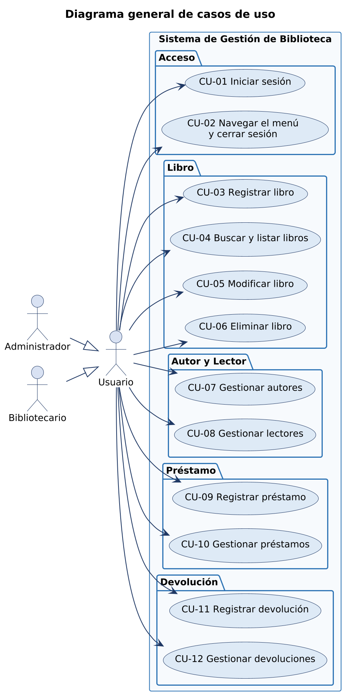
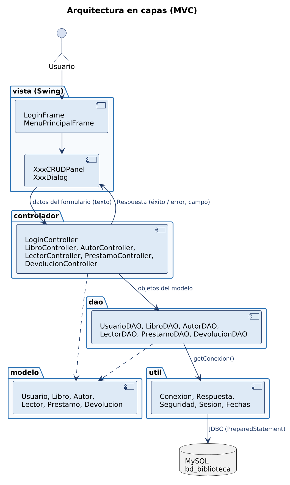
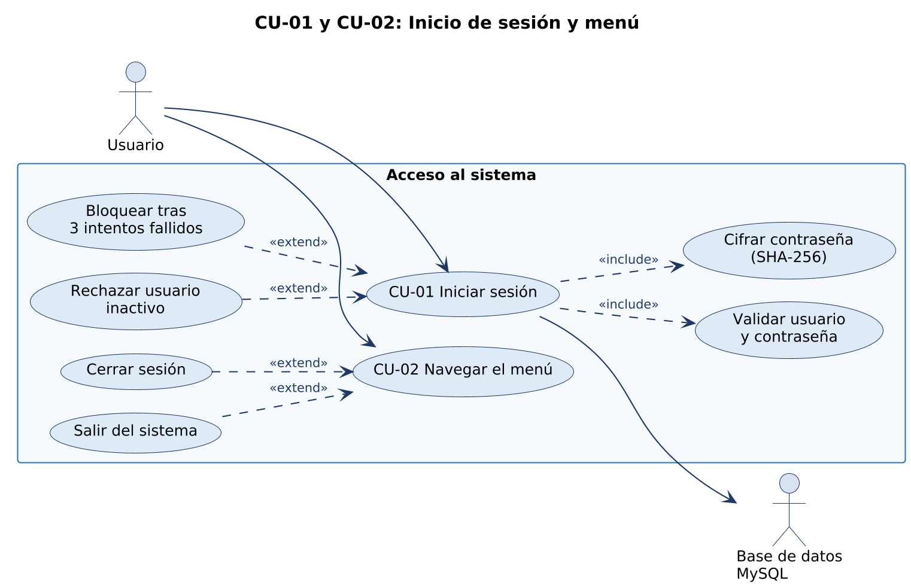
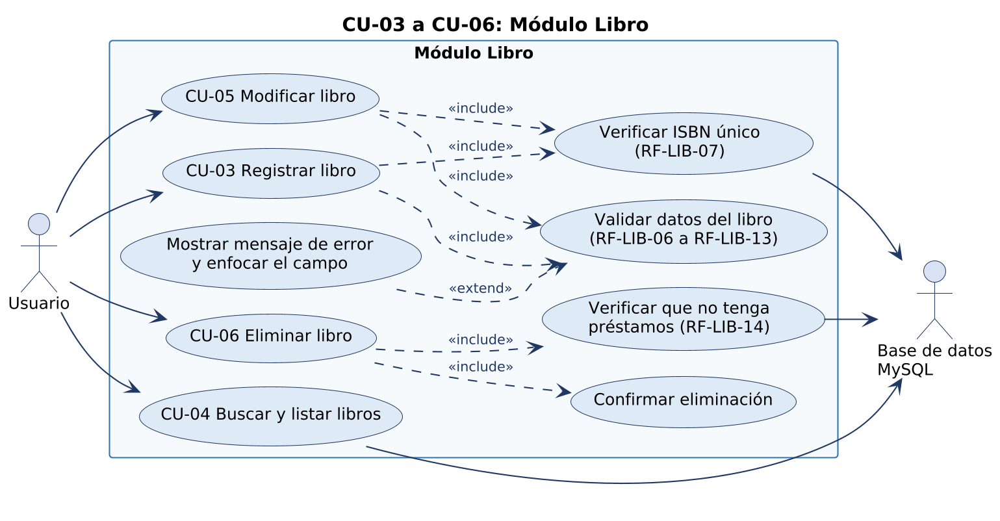
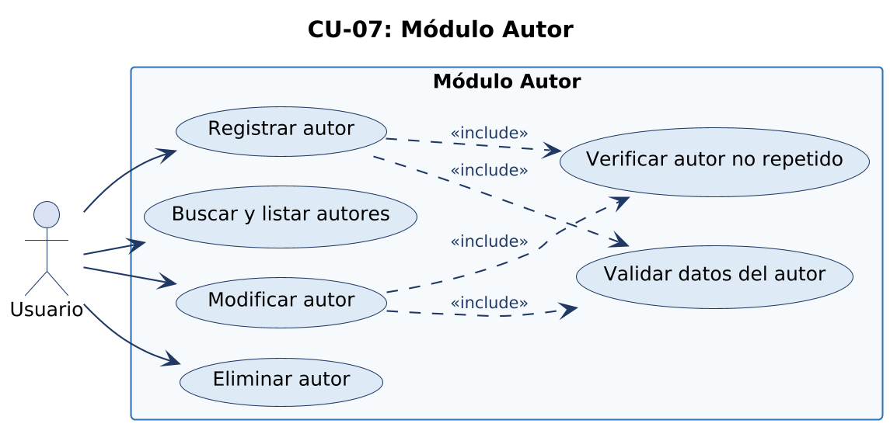
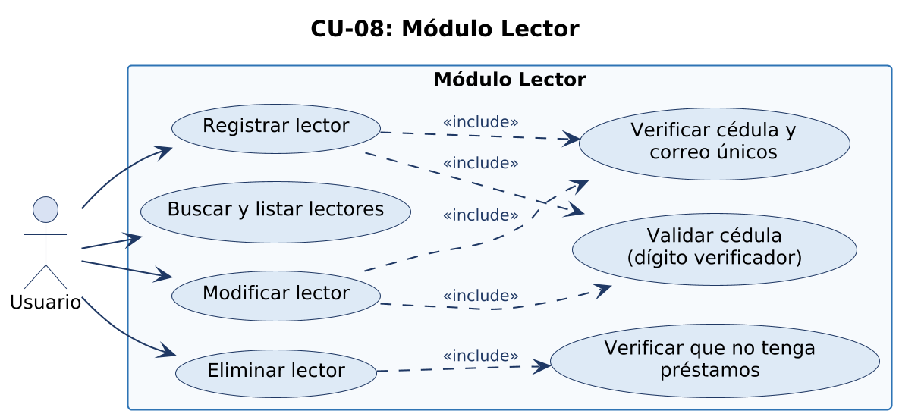
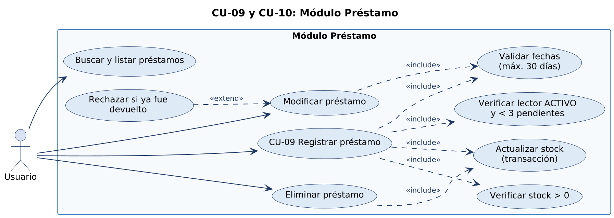
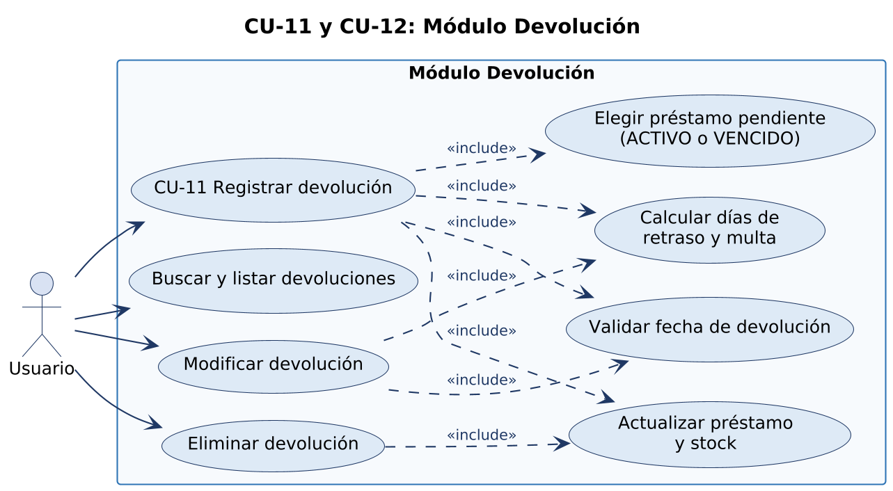

# Sistema de Gestión de Biblioteca

## 1. Descripción

Sistema de escritorio para una biblioteca, donde el personal (administrador y bibliotecarios) registra y controla
los **libros**, **autores** y **lectores**, y lleva el control de los **préstamos** de libros a los lectores y de sus
**devoluciones**, con cálculo de días de retraso y multa. El ingreso al sistema es con usuario y contraseña. Está
desarrollado en Java 17 con interfaz Swing, base de datos MySQL 8 y arquitectura en capas MVC (modelo, dao,
controlador, vista, util).

Este documento es la **especificación** contra la que se verifican las partes del sistema y el producto final: cada
prueba (análisis estático, JUnit, DU-cadena y pruebas dinámicas) se rastrea a un requerimiento numerado.

**Actores**

| Actor | Descripción |
|-------|-------------|
| **Administrador** | Usuario con rol ADMINISTRADOR (`admin`). Usa todos los módulos. |
| **Bibliotecario** | Usuario con rol BIBLIOTECARIO (`bibliotecario`). Usa todos los módulos. |
| **Sistema / Base de datos MySQL** | Actor secundario: guarda y consulta la información (`bd_biblioteca`). |

En esta versión ambos roles tienen los mismos permisos; en los casos de uso se los llama **Usuario**.

**Integrantes y módulos**

| Módulo | Tipo |
|--------|------|
| Módulo Libro - (                            ) | Independiente |
| Módulo Autor - (                            ) | Independiente |
| Módulo Lector - (                            ) | Independiente |
| Módulo Préstamo - (                            ) | Depende de Libro y Lector |
| Módulo Devolución - (                            ) | Depende de Préstamo |

Cada integrante escribe su nombre en el paréntesis del título de su módulo (sección 3).

---

## 2. Grupo (trabajo grupal)

Esta sección la elabora todo el grupo.

### 2.1 Modelo Entidad-Relación (Grupal)

{width=16cm}

Un **libro** y un **lector** pueden tener muchos **préstamos**; cada préstamo es de un solo libro y un solo lector.
Cada préstamo se cierra con **una** **devolución** como máximo. **Usuario** guarda las cuentas de acceso y **autor** es
un catálogo independiente.

### 2.2 Diagrama de Casos de Uso General (Grupal)

{width=9cm}

El usuario del sistema puede ser Administrador o Bibliotecario (generalización); ambos tienen acceso a todos los casos de uso.

### 2.3 Arquitectura del sistema (Grupal)

{width=11cm}

La vista envía los datos del formulario como texto al controlador; el controlador valida, aplica las reglas de
negocio y usa el DAO, que accede a MySQL con `PreparedStatement` mediante `util.Conexion`. El controlador responde con
un `util.Respuesta` (éxito o error y el campo con error).

### 2.4 Formato de los requerimientos funcionales (Grupal)

Cada requerimiento funcional se escribe para que sea **verificable**: dice qué recibe el sistema, qué hace, qué
devuelve y cómo se comprueba que se cumple. Así cada caso de prueba puede citar el RF y comparar el resultado obtenido
con el resultado esperado.

| Atributo | Significado |
|----------|-------------|
| **ID** | Identificador único `RF-<módulo>-<número>` (GEN, LOG, MEN, LIB, AUT, LEC, PRE, DEV). |
| **Nombre** | Qué hace el sistema, en pocas palabras. |
| **Descripción** | "El sistema debe…", una sola capacidad por requerimiento. |
| **Entradas** | Datos que ingresa el usuario o que vienen de la base de datos. |
| **Proceso** | Reglas y validaciones que aplica el sistema. |
| **Salidas** | Resultado visible: mensaje, cambio en la tabla, cambio en la base. |
| **Prioridad** | **Alta** (sin esto el sistema no sirve), **Media** (necesario pero hay alternativa), **Baja** (comodidad). |
| **Criterio de aceptación** | Condición observable que debe cumplirse para dar el RF por verificado. |
| **Implementado en** | Clase y método del código donde se cumple (sirve para el análisis estático y JUnit). |

Reglas comunes a todos los módulos (aplican a cada RF de registro y modificación):

* Los textos se evalúan sin los espacios del inicio y del final (`trim`).
* Los campos se validan **en el orden del formulario** y se informa solo **el primer error**, enfocando ese campo.
* Toda operación termina con un mensaje de éxito o de error en una ventana emergente.
* Si la base de datos falla, el mensaje es "Error de base de datos: \<detalle\>" y no se pierde lo escrito en el formulario.

### 2.5 Acceso al sistema: conexión, inicio de sesión y menú (Grupal)

#### Requerimientos funcionales

##### Resumen

| ID | Nombre | Prioridad |
|----|--------|-----------|
| RF-GEN-01 | Conectar con la base de datos | Alta |
| RF-LOG-01 | Iniciar sesión | Alta |
| RF-LOG-02 | Validar el nombre de usuario | Alta |
| RF-LOG-03 | Validar la contraseña | Alta |
| RF-LOG-04 | Rechazar credenciales incorrectas | Alta |
| RF-LOG-05 | Rechazar usuarios inactivos | Alta |
| RF-LOG-06 | Bloquear tras 3 intentos fallidos | Media |
| RF-MEN-01 | Acceder a los módulos desde el menú | Alta |
| RF-MEN-02 | Cerrar sesión y salir | Media |

| **RF-GEN-01** | **Conectar con la base de datos** |
|---|---|
| Prioridad | Alta |
| Descripción | El sistema debe abrir la conexión con la base MySQL `bd_biblioteca` cada vez que necesita leer o guardar datos. |
| Entradas | URL, usuario y contraseña definidos en `util.Conexion`. |
| Proceso | Carga el driver JDBC y abre la conexión. |
| Salidas | Conexión abierta, o mensaje de error si el servidor no responde o las credenciales son erróneas. |
| Criterio de aceptación | Con MySQL detenido, al iniciar sesión aparece "No se pudo conectar con la base de datos: …" y la aplicación no se cae. |
| Implementado en | `util.Conexion.getConexion` |

| **RF-LOG-01** | **Iniciar sesión** |
|---|---|
| Prioridad | Alta |
| Descripción | El sistema debe permitir el ingreso solo a usuarios registrados y activos. |
| Entradas | Usuario, contraseña. |
| Proceso | Valida los campos (RF-LOG-02, RF-LOG-03), cifra la contraseña con SHA-256 y busca el par usuario/hash en la tabla `usuario`. |
| Salidas | "Bienvenido, \<nombres\>", se guarda la sesión y se abre el menú principal. |
| Criterio de aceptación | `admin` / `Admin123` y `bibliotecario` / `Biblio123` abren el menú principal. |
| Implementado en | `LoginController.iniciarSesion`, `UsuarioDAO.autenticar`, `util.Sesion` |

| **RF-LOG-02** | **Validar el nombre de usuario** |
|---|---|
| Prioridad | Alta |
| Descripción | El usuario debe ser obligatorio, sin espacios internos y de máximo 30 caracteres. |
| Criterio de aceptación | vacío → "El usuario es obligatorio"; `ad min` → "El usuario no debe contener espacios"; 31 caracteres → "El usuario no puede superar 30 caracteres". |
| Implementado en | `LoginController.validarUsuario` |

| **RF-LOG-03** | **Validar la contraseña** |
|---|---|
| Prioridad | Alta |
| Descripción | La contraseña debe ser obligatoria y tener al menos 6 caracteres. |
| Criterio de aceptación | vacía → "La contraseña es obligatoria"; `12345` → "La contraseña debe tener al menos 6 caracteres". |
| Implementado en | `LoginController.validarContrasena` |

| **RF-LOG-04** | **Rechazar credenciales incorrectas** |
|---|---|
| Prioridad | Alta |
| Descripción | Si el usuario no existe o la contraseña no coincide, el sistema debe negar el ingreso sin indicar cuál de los dos falló. |
| Criterio de aceptación | `admin` / `Admin999` → "Usuario o contraseña incorrectos" y el foco va a la contraseña. |
| Implementado en | `LoginController.iniciarSesion` |

| **RF-LOG-05** | **Rechazar usuarios inactivos** |
|---|---|
| Prioridad | Alta |
| Descripción | Un usuario con estado inactivo no debe poder ingresar aunque su contraseña sea correcta. |
| Criterio de aceptación | `invitado` / `Invitado123` → "El usuario está inactivo. Contacte al administrador". |
| Implementado en | `LoginController.iniciarSesion` |

| **RF-LOG-06** | **Bloquear tras 3 intentos fallidos** |
|---|---|
| Prioridad | Media |
| Descripción | Después de 3 intentos de ingreso fallidos el sistema debe avisar y cerrarse. |
| Criterio de aceptación | Al tercer error aparece "Superó el número máximo de intentos. El sistema se cerrará." y la aplicación termina. |
| Implementado en | `LoginFrame.MAX_INTENTOS`, `LoginFrame` (contador `intentosFallidos`) |

| **RF-MEN-01** | **Acceder a los módulos desde el menú** |
|---|---|
| Prioridad | Alta |
| Descripción | El menú principal debe mostrar los módulos Libros, Autores, Lectores, Préstamos y Devoluciones, tanto en la barra de menú como en botones laterales. |
| Criterio de aceptación | Cada opción abre el panel de su módulo con la tabla cargada. |
| Implementado en | `MenuPrincipalFrame` |

| **RF-MEN-02** | **Cerrar sesión y salir** |
|---|---|
| Prioridad | Media |
| Descripción | El usuario debe poder cerrar sesión (volver al login) o salir de la aplicación (Ctrl+Q), en ambos casos con confirmación. |
| Criterio de aceptación | Al responder "Sí" se vuelve al login o se cierra la aplicación; al responder "No" se queda en el menú. |
| Implementado en | `MenuPrincipalFrame`, `LoginController.cerrarSesion` |

#### Casos de uso

{width=15cm}

##### CU-01 Iniciar sesión
| Elemento | Descripción |
|----------|-------------|
| Actor | Usuario |
| Requerimientos | RF-GEN-01, RF-LOG-01 a RF-LOG-06 |
| Precondición | La base de datos está disponible y el usuario existe. |
| Flujo básico | 1. El sistema muestra la ventana de login. 2. El usuario escribe usuario y contraseña y pulsa **Ingresar**. 3. El sistema valida los campos. 4. El sistema cifra la contraseña con SHA-256 y busca el usuario. 5. El sistema verifica que el usuario esté activo. 6. El sistema guarda la sesión, muestra "Bienvenido, \<nombre\>" y abre el menú principal. |
| Flujos alternos | 3a. Usuario vacío, con espacios o >30 caracteres, o contraseña vacía o <6 caracteres: muestra el error y enfoca el campo. 4a. Credenciales incorrectas: muestra "Usuario o contraseña incorrectos" y suma un intento; al tercer intento muestra un aviso y cierra el sistema. 5a. Usuario inactivo (`invitado`): muestra el mensaje de inactivo. 4b. Falla la conexión: "No se pudo conectar con la base de datos". El usuario pulsa **Salir**: termina la aplicación. |
| Postcondición | Sesión iniciada y menú principal visible. |

##### CU-02 Navegar el menú y cerrar sesión
| Elemento | Descripción |
|----------|-------------|
| Actor | Usuario |
| Requerimientos | RF-MEN-01, RF-MEN-02 |
| Precondición | Sesión iniciada (CU-01). |
| Flujo básico | 1. El usuario elige un módulo en la barra de menú o en los botones laterales. 2. El sistema muestra el panel del módulo con sus datos. |
| Flujos alternos | 1a. **Cerrar sesión**: el sistema pide confirmación, cierra la sesión y vuelve al login. 1b. **Salir** (Ctrl+Q): pide confirmación y cierra la aplicación. 1c. El usuario responde "No": se queda en el menú. |
| Postcondición | Módulo visible, o sesión cerrada. |

#### Interfaces (Pantallas)

[[CAPTURA: Ventana de inicio de sesión]]

[[CAPTURA: Mensaje de usuario o contraseña incorrectos]]

[[CAPTURA: Menú principal]]

### 2.6 Requerimientos no funcionales (Grupal)

Clasificados según las características de calidad de la norma **ISO/IEC 25010**. Cada uno indica un criterio
**medible** y **cómo se verifica**, para que también puedan probarse y no queden como frases generales.

| ID | Característica (ISO 25010) | Requerimiento | Criterio medible | Cómo se verifica | Prioridad |
|----|----------------------------|---------------|------------------|------------------|-----------|
| RNF-01 | Seguridad · Confidencialidad | Las contraseñas no se guardan en texto plano. | 100 % de las contraseñas en la tabla `usuario` son hash SHA-256 (64 caracteres hexadecimales). | Consulta `SELECT contrasena FROM usuario`; revisión de `util.Seguridad`. | Alta |
| RNF-02 | Seguridad · Integridad | Protección contra inyección SQL. | 100 % de las consultas usan `PreparedStatement` con parámetros `?`; ninguna concatena datos del usuario. | Revisión de código de los 6 DAO; login con `' OR '1'='1` debe fallar. | Alta |
| RNF-03 | Seguridad · Autenticidad | Acceso solo con sesión iniciada y límite de intentos. | Ningún módulo se abre sin login; máximo 3 intentos fallidos. | Prueba dinámica del login (CU-01). | Alta |
| RNF-04 | Fiabilidad · Tolerancia a fallos | Los errores no cierran la aplicación. | Ante una falla de base de datos se muestra un mensaje y la aplicación sigue abierta (0 excepciones sin capturar). | Detener MySQL y realizar una operación de cada módulo. | Alta |
| RNF-05 | Fiabilidad · Integridad de datos | Las operaciones que cambian préstamo y stock son atómicas. | Si falla un paso, no queda ningún cambio a medias (transacción con `commit`/`rollback`); el stock nunca es negativo. | Revisión de `PrestamoDAO` y `DevolucionDAO`; claves foráneas y `CHECK` en `bd_biblioteca.sql`. | Alta |
| RNF-06 | Eficiencia de desempeño · Tiempo de respuesta | Las consultas responden rápido. | Listar, buscar y guardar tardan menos de 2 segundos con los datos de prueba. | Medición con cronómetro o `System.currentTimeMillis()` en pruebas dinámicas. | Media |
| RNF-07 | Usabilidad · Protección contra errores del usuario | El sistema guía al usuario cuando se equivoca. | 100 % de los errores de validación muestran un mensaje en español que indica el campo y la regla; el foco va al campo; eliminar, cerrar sesión y salir piden confirmación; valores cerrados (género, estado) se eligen de una lista. | Pruebas dinámicas de cada formulario. | Alta |
| RNF-08 | Usabilidad · Aprendizaje | Interfaz uniforme. | Los 5 módulos tienen los mismos botones (Nuevo, Editar, Eliminar, Buscar, Mostrar todos) en la misma posición; doble clic edita. | Inspección de las capturas en `docs/capturas`. | Media |
| RNF-09 | Mantenibilidad · Modularidad | Arquitectura en capas MVC. | La vista no contiene SQL; cada módulo tiene sus 5 clases (modelo, DAO, controlador, panel, diálogo). | Revisión de paquetes: `grep` de `SELECT` solo en `dao`. | Alta |
| RNF-10 | Mantenibilidad · Analizabilidad | Código fácil de analizar. | Un método `validarXxx` por campo con complejidad ciclomática ≤ 10; 100 % de las clases públicas con Javadoc. | Análisis estático (grafo de flujo y V(G)); `docs/javadoc`. | Media |
| RNF-11 | Mantenibilidad · Capacidad de ser probado | Los controladores se prueban sin base de datos. | Todos los controladores aceptan el DAO por constructor; las validaciones son métodos públicos que devuelven el mensaje o `null`. | Pruebas JUnit con DAO simulado. | Alta |
| RNF-12 | Portabilidad · Instalabilidad | Instalación sencilla. | Java 17+, MySQL 8 y Maven; la base se crea ejecutando un solo script (`database/bd_biblioteca.sql`); solo se configura la contraseña en `util.Conexion`. | Instalar en un equipo nuevo siguiendo el README. | Media |
| RNF-13 | Adecuación funcional · Corrección | Formatos consistentes. | Fechas siempre `dd/MM/yyyy`; montos con 2 decimales (`BigDecimal`). | Pruebas JUnit de `util.Fechas` y `calcularMulta`. | Media |
| RNF-14 | Compatibilidad · Coexistencia | Funciona en Windows con NetBeans o IntelliJ. | La aplicación compila con `mvn package` y se ejecuta desde `vista.SistemaBiblioteca`. | Ejecución en el equipo de cada integrante. | Baja |

---

## 3. Individual (trabajo de cada integrante)

Cada integrante completa su módulo: nombre en el título, requerimientos funcionales (crear, consultar, actualizar y
eliminar), casos de uso y las capturas de sus pantallas.

### 3.1 Módulo Libro - (                            )

#### 3.1.1 Requerimientos funcionales (CRU)

##### Resumen

| ID | Nombre | Tipo | Prioridad |
|----|--------|------|-----------|
| RF-LIB-01 | Registrar libro | Operación (C) | Alta |
| RF-LIB-02 | Listar libros | Operación (R) | Alta |
| RF-LIB-03 | Buscar libros | Operación (R) | Media |
| RF-LIB-04 | Modificar libro | Operación (U) | Alta |
| RF-LIB-05 | Eliminar libro | Operación (D) | Alta |
| RF-LIB-06 | Validar ISBN | Validación | Alta |
| RF-LIB-07 | Controlar ISBN único | Regla de negocio | Alta |
| RF-LIB-08 | Validar título | Validación | Alta |
| RF-LIB-09 | Validar editorial | Validación | Alta |
| RF-LIB-10 | Validar año de publicación | Validación | Alta |
| RF-LIB-11 | Validar género | Validación | Alta |
| RF-LIB-12 | Validar número de páginas | Validación | Media |
| RF-LIB-13 | Validar stock | Validación | Alta |
| RF-LIB-14 | Impedir eliminar libros con préstamos | Regla de negocio | Alta |
| RF-LIB-15 | Exigir un libro seleccionado y existente | Regla de negocio | Media |
| RF-LIB-16 | Informar el resultado de cada operación | Interfaz | Media |

##### Especificación de operaciones

| **RF-LIB-01** | **Registrar libro** |
|---|---|
| Prioridad | Alta |
| Descripción | El sistema debe permitir registrar un libro nuevo. |
| Entradas | ISBN, título, editorial, año de publicación, género, número de páginas, stock (todos como texto del formulario). |
| Proceso | 1) Valida los campos en orden: ISBN → título → editorial → año → género → páginas → stock (RF-LIB-06 a RF-LIB-13). 2) Verifica que el ISBN no exista (RF-LIB-07). 3) Inserta el registro en la tabla `libro`. |
| Salidas | "Libro registrado correctamente"; el formulario se cierra y la tabla se actualiza. |
| Criterio de aceptación | Con `9789942000001`, "La vorágine", "Editorial Planeta", `1924`, Novela, `320`, `3` el libro aparece en la tabla con esos datos. |
| Implementado en | `LibroController.registrarLibro`, `validarCampos`, `LibroDAO.insertar` |

| **RF-LIB-02** | **Listar libros** |
|---|---|
| Prioridad | Alta |
| Descripción | El sistema debe mostrar todos los libros registrados al abrir el módulo y al pulsar "Mostrar todos". |
| Salidas | Tabla con id, ISBN, título, editorial, año, género, páginas y stock. |
| Criterio de aceptación | Con el script de datos de prueba recién ejecutado se muestran los 15 libros. |
| Implementado en | `LibroController.listarLibros`, `LibroDAO.listar` |

| **RF-LIB-03** | **Buscar libros** |
|---|---|
| Prioridad | Media |
| Descripción | El sistema debe filtrar los libros cuyo ISBN, título, editorial o género contengan el texto escrito (coincidencia parcial). |
| Entradas | Texto de búsqueda. |
| Proceso | Si el texto está vacío lista todos (RF-LIB-02); si no, consulta con `LIKE %texto%`. |
| Salidas | Tabla con las coincidencias; vacía si no hay ninguna. |
| Criterio de aceptación | Buscar "Novela" muestra solo libros de ese género; buscar "zzz" deja la tabla vacía; texto vacío muestra los 15. |
| Implementado en | `LibroController.buscarLibros`, `LibroDAO.buscar` |

| **RF-LIB-04** | **Modificar libro** |
|---|---|
| Prioridad | Alta |
| Descripción | El sistema debe permitir cambiar los datos de un libro seleccionado (botón Editar o doble clic). |
| Entradas | Id del libro seleccionado y los mismos campos de RF-LIB-01. |
| Proceso | 1) Verifica que haya un libro seleccionado (RF-LIB-15). 2) Valida los campos igual que al registrar. 3) Verifica que el ISBN no pertenezca a **otro** libro. 4) Actualiza el registro. |
| Salidas | "Libro actualizado correctamente"; la tabla muestra los nuevos datos. |
| Criterio de aceptación | Cambiar solo el stock de un libro conserva su ISBN y no da error de ISBN repetido. |
| Implementado en | `LibroController.actualizarLibro`, `LibroDAO.actualizar` |

| **RF-LIB-05** | **Eliminar libro** |
|---|---|
| Prioridad | Alta |
| Descripción | El sistema debe permitir eliminar un libro seleccionado después de pedir confirmación. |
| Proceso | 1) Verifica selección y existencia (RF-LIB-15). 2) Verifica que no tenga préstamos (RF-LIB-14). 3) Borra el registro. |
| Salidas | "Libro eliminado correctamente"; el libro desaparece de la tabla. Si el usuario responde "No" en la confirmación, no pasa nada. |
| Criterio de aceptación | El libro id 9 (sin préstamos) se elimina. |
| Implementado en | `LibroController.eliminarLibro`, `LibroDAO.eliminar` |

##### Especificación de validaciones y reglas

En cada validación, la columna **Mensaje** es el resultado esperado exacto para las pruebas.

| **RF-LIB-06** | **Validar ISBN** |
|---|---|
| Prioridad | Alta |
| Regla | obligatorio; solo dígitos (sin guiones ni espacios); exactamente 10 o 13 dígitos. |
| Implementado en | `LibroController.validarIsbn` |

| Condición | Ejemplo | Mensaje |
|-----------|---------|---------|
| Vacío o solo espacios | `""`, `"   "` | El ISBN es obligatorio |
| Contiene letras, guiones o espacios internos | `978-9942`, `12345abcde` | El ISBN solo debe contener números (sin guiones ni espacios) |
| Longitud distinta de 10 y 13 | `123456789` (9), `12345678901` (11) | El ISBN debe tener 10 o 13 dígitos |
| Válido | `1234567890`, `9789942000001` | (sin error) |

| **RF-LIB-07** | **Controlar ISBN único** |
|---|---|
| Prioridad | Alta |
| Regla | no puede haber dos libros con el mismo ISBN. Al modificar se excluye el propio libro. |
| Mensaje | al registrar "Ya existe un libro registrado con ese ISBN"; al modificar "Ya existe otro libro registrado con ese ISBN". |
| Implementado en | `LibroDAO.existeIsbn` |

| **RF-LIB-08** | **Validar título** |
|---|---|
| Prioridad | Alta |
| Implementado en | `validarTitulo` |

| Condición | Mensaje |
|-----------|---------|
| Vacío | El título es obligatorio |
| Menos de 2 caracteres | El título debe tener al menos 2 caracteres |
| Más de 150 caracteres | El título no puede superar 150 caracteres |

* **Valores límite:** 1 ✗, 2 ✓, 150 ✓, 151 ✗.

| **RF-LIB-09** | **Validar editorial** |
|---|---|
| Prioridad | Alta |
| Implementado en | `validarEditorial` |

| Condición | Mensaje |
|-----------|---------|
| Vacía | La editorial es obligatoria |
| Caracteres distintos de letras, números, espacios y `. , & ' -` | La editorial contiene caracteres no permitidos |
| Menos de 2 o más de 100 caracteres | La editorial debe tener entre 2 y 100 caracteres |

* **Valores límite:** 1 ✗, 2 ✓, 100 ✓, 101 ✗. Ejemplo inválido: `Editorial#1`.

| **RF-LIB-10** | **Validar año de publicación** |
|---|---|
| Prioridad | Alta |
| Implementado en | `validarAnioPublicacion` |

| Condición | Mensaje |
|-----------|---------|
| Vacío | El año de publicación es obligatorio |
| No numérico o más de 4 dígitos | El año de publicación debe ser un número de hasta 4 dígitos |
| Menor a 1450 | El año de publicación no puede ser menor a 1450 |
| Mayor al año actual | El año de publicación no puede ser mayor al año actual |

* **Valores límite:** 1449 ✗, 1450 ✓, año actual ✓, año actual + 1 ✗.

| **RF-LIB-11** | **Validar género** |
|---|---|
| Prioridad | Alta |
| Regla | uno de Novela, Cuento, Poesía, Ciencia, Historia, Tecnología, Infantil, Otro (lista desplegable). |
| Implementado en | `validarGenero` |

| Condición | Mensaje |
|-----------|---------|
| Sin seleccionar | Debe seleccionar un género |
| Valor fuera de la lista | El género seleccionado no es válido |

| **RF-LIB-12** | **Validar número de páginas** |
|---|---|
| Prioridad | Media |
| Implementado en | `validarNumeroPaginas` |

| Condición | Mensaje |
|-----------|---------|
| Vacío | El número de páginas es obligatorio |
| No entero, negativo o más de 4 dígitos | El número de páginas debe ser un número entero |
| Menor a 1 o mayor a 5000 | El número de páginas debe estar entre 1 y 5000 |

* **Valores límite:** 0 ✗, 1 ✓, 5000 ✓, 5001 ✗.

| **RF-LIB-13** | **Validar stock** |
|---|---|
| Prioridad | Alta |
| Implementado en | `validarStock` |

| Condición | Mensaje |
|-----------|---------|
| Vacío | El stock es obligatorio |
| No entero, negativo o más de 3 dígitos | El stock debe ser un número entero no negativo |
| Mayor a 500 | El stock no puede superar 500 ejemplares |

* **Valores límite:** -1 ✗, 0 ✓, 500 ✓, 501 ✗.

| **RF-LIB-14** | **Impedir eliminar libros con préstamos** |
|---|---|
| Prioridad | Alta |
| Regla | un libro con al menos un préstamo (de cualquier estado) no se elimina. |
| Mensaje | "No se puede eliminar: el libro tiene préstamos registrados". |
| Criterio de aceptación | el libro id 1 no se elimina; el id 9 sí. |
| Implementado en | `LibroDAO.tienePrestamos` |

| **RF-LIB-15** | **Exigir un libro seleccionado y existente** |
|---|---|
| Prioridad | Media |
| Implementado en | `actualizarLibro`, `eliminarLibro` |

| Condición | Mensaje |
|-----------|---------|
| Ningún libro seleccionado (id ≤ 0) al modificar | Debe seleccionar un libro para modificar |
| Ningún libro seleccionado (id ≤ 0) al eliminar | Debe seleccionar un libro para eliminar |
| El libro fue borrado antes de modificarlo | El libro ya no existe en la base de datos |
| El libro no existe al eliminar | El libro no existe |

| **RF-LIB-16** | **Informar el resultado de cada operación** |
|---|---|
| Prioridad | Media |
| Descripción | después de guardar o eliminar, el sistema debe mostrar un mensaje de éxito o de error; si el error es de un campo, el cursor se coloca en ese campo y el formulario no se cierra. |
| Implementado en | `util.Respuesta`, `LibroDialog` |

#### 3.1.2 Casos de uso

{width=16cm}

##### CU-03 Registrar libro
| Elemento | Descripción |
|----------|-------------|
| Actor | Usuario |
| Requerimientos | RF-LIB-01, RF-LIB-06 a RF-LIB-13, RF-LIB-16 |
| Precondición | Sesión iniciada; el usuario está en el módulo Libros. |
| Flujo básico | 1. El usuario pulsa **Nuevo**. 2. El sistema abre el formulario vacío. 3. El usuario ingresa ISBN, título, editorial, año, género, páginas y stock y pulsa **Guardar**. 4. El sistema valida los campos en orden (ISBN → título → editorial → año → género → páginas → stock). 5. El sistema verifica que el ISBN no exista. 6. El sistema guarda el libro. 7. El sistema muestra "Libro registrado correctamente", cierra el formulario y actualiza la tabla. |
| Flujos alternos | 4a. Un campo no cumple su regla: muestra el mensaje del campo (RF-LIB-06 a RF-LIB-13), enfoca ese campo y vuelve al paso 3. 5a. ISBN repetido: "Ya existe un libro registrado con ese ISBN" y vuelve al paso 3. 6a. Error de base de datos: "Error de base de datos: …". 3a. El usuario pulsa **Cancelar**: se cierra el formulario sin guardar. |
| Postcondición | El libro queda registrado en la tabla `libro`. |

##### CU-04 Buscar y listar libros
| Elemento | Descripción |
|----------|-------------|
| Actor | Usuario |
| Requerimientos | RF-LIB-02, RF-LIB-03 |
| Precondición | Sesión iniciada; módulo Libros abierto. |
| Flujo básico | 1. El sistema muestra todos los libros al abrir el módulo. 2. El usuario escribe un texto y pulsa **Buscar**. 3. El sistema muestra los libros cuyo ISBN, título, editorial o género contienen el texto. |
| Flujos alternos | 2a. Texto vacío o **Mostrar todos**: muestra todos los libros. 3a. No hay coincidencias: la tabla queda vacía. |
| Postcondición | La tabla muestra el resultado. |

##### CU-05 Modificar libro
| Elemento | Descripción |
|----------|-------------|
| Actor | Usuario |
| Requerimientos | RF-LIB-04, RF-LIB-06 a RF-LIB-13, RF-LIB-15, RF-LIB-16 |
| Precondición | Sesión iniciada; hay al menos un libro. |
| Flujo básico | 1. El usuario selecciona un libro y pulsa **Editar** (o doble clic). 2. El sistema abre el formulario con los datos actuales. 3. El usuario cambia los datos y pulsa **Guardar**. 4. El sistema valida los campos (igual que CU-03). 5. El sistema verifica que el ISBN no pertenezca a **otro** libro. 6. El sistema actualiza y muestra "Libro actualizado correctamente". |
| Flujos alternos | 1a. No hay libro seleccionado: "Debe seleccionar un libro para modificar". 4a. Dato inválido: muestra el error del campo. 5a. ISBN de otro libro: "Ya existe otro libro registrado con ese ISBN". 6a. El libro fue borrado: "El libro ya no existe en la base de datos". |
| Postcondición | Los datos del libro quedan actualizados. |

##### CU-06 Eliminar libro
| Elemento | Descripción |
|----------|-------------|
| Actor | Usuario |
| Requerimientos | RF-LIB-05, RF-LIB-14, RF-LIB-15 |
| Precondición | Sesión iniciada; hay al menos un libro. |
| Flujo básico | 1. El usuario selecciona un libro y pulsa **Eliminar**. 2. El sistema pide confirmación. 3. El usuario confirma. 4. El sistema verifica que el libro exista y no tenga préstamos. 5. El sistema lo elimina y muestra "Libro eliminado correctamente". |
| Flujos alternos | 1a. Sin selección: "Debe seleccionar un libro para eliminar". 3a. El usuario cancela: no se elimina. 4a. No existe: "El libro no existe". 4b. Tiene préstamos: "No se puede eliminar: el libro tiene préstamos registrados" (p. ej. libros 1–8, 11, 12 del script). |
| Postcondición | El libro ya no aparece en la tabla. |

#### 3.1.3 Interfaces (Pantallas)

Capturas de las pantallas del módulo funcionando. Pegue cada captura en el cuadro correspondiente.

[[CAPTURA: Pantalla principal del módulo Libro (tabla con los libros y búsqueda)]]

[[CAPTURA: Formulario Nuevo libro con datos válidos]]

[[CAPTURA: Mensaje de error de validación (campo enfocado)]]

[[CAPTURA: Mensaje de éxito al guardar / confirmación al eliminar]]

#### 3.1.4 Matriz de trazabilidad

Sirve para el documento de pruebas: cada prueba debe citar el RF que verifica.

| Requerimiento | Caso de uso | Método a probar | Pruebas sugeridas |
|---------------|-------------|-----------------|-------------------|
| RF-LIB-06 ISBN válido | CU-03, CU-05 | `validarIsbn` (V(G) = 6) | Análisis estático (grafo, CC, caminos), JUnit: null, "", "12a4567890", "123456789", "1234567890", "9781234567897" |
| RF-LIB-07 ISBN único | CU-03, CU-05 | `registrarLibro`, `actualizarLibro` | JUnit con DAO simulado; prueba dinámica con ISBN del script |
| RF-LIB-01 Registrar | CU-03 | `registrarLibro` | Análisis estático, DU-cadena (variables `validacion`, `libro`), JUnit |
| RF-LIB-08 a RF-LIB-13 | CU-03, CU-05 | `validarTitulo` … `validarStock` | Valores límite: título 1/2/150/151; año 1449/1450/actual/actual+1; páginas 0/1/5000/5001; stock -1/0/500/501 |
| RF-LIB-14 | CU-06 | `eliminarLibro` | Libro con préstamos (id 1) vs. sin préstamos (id 9) |
| RF-LIB-15 | CU-05, CU-06 | `actualizarLibro`, `eliminarLibro` | id ≤ 0, id inexistente |
| RF-LIB-02, RF-LIB-03 | CU-04 | `buscarLibros` | Texto vacío, coincidencia parcial, sin resultados |
| RF-LOG-01 a RF-LOG-06 | CU-01 | `LoginController.iniciarSesion` | admin/Admin123 (éxito), clave errónea ×3, `invitado` inactivo |

---

### 3.2 Módulo Autor - (                            )

#### 3.2.1 Requerimientos funcionales (CRU)

| ID | Nombre | Descripción / regla | Mensaje de error esperado | Prioridad |
|----|--------|---------------------|---------------------------|-----------|
| RF-AUT-01 | Registrar autor | Guarda un autor nuevo con nombres, apellidos, nacionalidad, fecha de nacimiento y biografía. | — ("Autor registrado correctamente") | Alta |
| RF-AUT-02 | Listar y buscar autores | Muestra todos o filtra por nombres, apellidos o nacionalidad. | — | Media |
| RF-AUT-03 | Modificar autor | Cambia los datos del autor seleccionado. | Debe seleccionar un autor para modificar | Alta |
| RF-AUT-04 | Eliminar autor | Borra el autor seleccionado con confirmación. | Debe seleccionar un autor para eliminar / El autor no existe | Alta |
| RF-AUT-05 | Validar nombres y apellidos | Obligatorios, solo letras (y `. ' -`), 2 a 60 caracteres. | Los nombres son obligatorios / solo deben contener letras / deben tener entre 2 y 60 caracteres | Alta |
| RF-AUT-06 | Validar nacionalidad | Obligatoria, solo letras y espacios, 3 a 50 caracteres. | La nacionalidad es obligatoria / solo debe contener letras / debe tener entre 3 y 50 caracteres | Alta |
| RF-AUT-07 | Validar fecha de nacimiento | Opcional; si se escribe: `dd/MM/yyyy`, fecha real, no futura, no anterior al año 1000. | …debe tener el formato dd/MM/yyyy y ser una fecha real / no puede ser futura / no puede ser anterior al año 1000 | Media |
| RF-AUT-08 | Validar biografía | Opcional, máximo 255 caracteres. | La biografía no puede superar 255 caracteres | Baja |
| RF-AUT-09 | Controlar autor duplicado | No se repiten los mismos nombres y apellidos. | Ya existe un autor registrado con ese nombre | Alta |

#### 3.2.2 Casos de uso

{width=14cm}

##### CU-07 Gestionar autores
| Elemento | Descripción |
|----------|-------------|
| Actor | Usuario |
| Requerimientos | RF-AUT-01 a RF-AUT-09 |
| Precondición | Sesión iniciada; módulo Autores abierto. |
| Flujo básico | 1. El usuario elige Nuevo, Editar, Eliminar o Buscar. 2. Para Nuevo/Editar ingresa nombres, apellidos, nacionalidad, fecha de nacimiento y biografía y pulsa Guardar. 3. El sistema valida los campos y que el autor no esté repetido. 4. El sistema guarda y muestra el mensaje de éxito. |
| Flujos alternos | 3a. Dato inválido: mensaje del campo. 3b. Autor repetido: se rechaza. Eliminar sin selección o autor inexistente: mensaje de error. |
| Postcondición | Autor registrado, actualizado o eliminado. |

#### 3.2.3 Interfaces (Pantallas)

Capturas de las pantallas del módulo funcionando. Pegue cada captura en el cuadro correspondiente.

[[CAPTURA: Pantalla principal del módulo Autor (tabla con los autores y búsqueda)]]

[[CAPTURA: Formulario Nuevo autor con datos válidos]]

[[CAPTURA: Mensaje de error de validación (campo enfocado)]]

[[CAPTURA: Mensaje de éxito al guardar / confirmación al eliminar]]

---

### 3.3 Módulo Lector - (                            )

#### 3.3.1 Requerimientos funcionales (CRU)

| ID | Nombre | Descripción / regla | Mensaje de error esperado | Prioridad |
|----|--------|---------------------|---------------------------|-----------|
| RF-LEC-01 | Registrar lector | Guarda un lector con cédula, nombres, apellidos, correo, teléfono, dirección y estado. | — | Alta |
| RF-LEC-02 | Listar y buscar lectores | Muestra todos o filtra por cédula, nombres, apellidos o correo. | — | Media |
| RF-LEC-03 | Modificar lector | Cambia los datos del lector seleccionado. | Debe seleccionar un lector para modificar | Alta |
| RF-LEC-04 | Eliminar lector | Borra el lector seleccionado con confirmación. | Debe seleccionar un lector para eliminar / El lector no existe | Alta |
| RF-LEC-05 | Validar cédula ecuatoriana | Obligatoria, 10 dígitos, provincia 01–24 o 30, tercer dígito < 6, dígito verificador (módulo 10) correcto. | La cédula es obligatoria / debe tener exactamente 10 dígitos numéricos / …no son un código de provincia válido / El tercer dígito… debe ser menor a 6 / …dígito verificador incorrecto | Alta |
| RF-LEC-06 | Validar nombres y apellidos | Obligatorios, solo letras y espacios, 2 a 60 caracteres. | …son obligatorios / …solo deben contener letras y espacios / …entre 2 y 60 caracteres | Alta |
| RF-LEC-07 | Validar correo | Obligatorio, formato `usuario@dominio.ext`, máximo 100 caracteres. | El correo es obligatorio / no puede superar 100 caracteres / no tiene un formato válido | Alta |
| RF-LEC-08 | Validar teléfono | Obligatorio, celular de 10 dígitos que empieza con 09. | El teléfono es obligatorio / debe tener 10 dígitos y empezar con 09 | Media |
| RF-LEC-09 | Validar dirección y estado | Dirección opcional, máx. 150; estado ACTIVO o SUSPENDIDO. | La dirección no puede superar 150 caracteres / Debe seleccionar un estado | Baja |
| RF-LEC-10 | Controlar cédula y correo únicos | No se repite la cédula ni el correo de otro lector. | Ya existe un lector registrado con esa cédula / con ese correo | Alta |
| RF-LEC-11 | Impedir eliminar lectores con préstamos | Un lector con préstamos no se elimina. | No se puede eliminar: el lector tiene préstamos registrados | Alta |

#### 3.3.2 Casos de uso

{width=14cm}

##### CU-08 Gestionar lectores
| Elemento | Descripción |
|----------|-------------|
| Actor | Usuario |
| Requerimientos | RF-LEC-01 a RF-LEC-11 |
| Precondición | Sesión iniciada; módulo Lectores abierto. |
| Flujo básico | 1. El usuario elige Nuevo o Editar. 2. Ingresa cédula, nombres, apellidos, correo, teléfono, dirección y estado y pulsa Guardar. 3. El sistema valida la cédula (incluido dígito verificador), los demás campos y que cédula y correo sean únicos. 4. El sistema guarda y muestra el mensaje de éxito. |
| Flujos alternos | 3a. Dato inválido o duplicado: mensaje del campo. Eliminar un lector con préstamos: se rechaza. |
| Postcondición | Lector registrado, actualizado o eliminado. |

#### 3.3.3 Interfaces (Pantallas)

Capturas de las pantallas del módulo funcionando. Pegue cada captura en el cuadro correspondiente.

[[CAPTURA: Pantalla principal del módulo Lector (tabla con los lectores y búsqueda)]]

[[CAPTURA: Formulario Nuevo lector con datos válidos]]

[[CAPTURA: Mensaje de error de validación (campo enfocado)]]

[[CAPTURA: Mensaje de éxito al guardar / confirmación al eliminar]]

---

### 3.4 Módulo Préstamo - (                            )

#### 3.4.1 Requerimientos funcionales (CRU)

| ID | Nombre | Descripción / regla | Mensaje de error esperado | Prioridad |
|----|--------|---------------------|---------------------------|-----------|
| RF-PRE-01 | Registrar préstamo | Registra el préstamo de un libro a un lector con estado ACTIVO. | — ("Préstamo registrado correctamente") | Alta |
| RF-PRE-02 | Listar y buscar préstamos | Muestra todos o filtra por título, lector, cédula o estado. | — | Media |
| RF-PRE-03 | Modificar préstamo | Cambia los datos de un préstamo no devuelto. | No se puede modificar un préstamo que ya fue devuelto | Alta |
| RF-PRE-04 | Eliminar préstamo | Borra un préstamo sin devolución y devuelve el ejemplar al stock. | No se puede eliminar: el préstamo tiene una devolución registrada | Alta |
| RF-PRE-05 | Validar libro y lector | Ambos obligatorios, elegidos de listas. | El libro seleccionado no existe / El lector seleccionado no existe | Alta |
| RF-PRE-06 | Validar fecha de préstamo | Obligatoria, `dd/MM/yyyy`, fecha real, no futura. | La fecha del préstamo es obligatoria / …no puede ser futura | Alta |
| RF-PRE-07 | Validar fecha límite | Obligatoria, no anterior al préstamo, máximo 30 días después. | …no puede ser anterior a la fecha del préstamo / …no puede superar 30 días desde el préstamo | Alta |
| RF-PRE-08 | Verificar stock | El libro debe tener al menos 1 ejemplar. | El libro no tiene ejemplares disponibles (stock 0) | Alta |
| RF-PRE-09 | Verificar lector habilitado | El lector debe estar ACTIVO y tener menos de 3 préstamos sin devolver. | El lector está SUSPENDIDO y no puede recibir préstamos / El lector ya tiene 3 préstamos sin devolver | Alta |
| RF-PRE-10 | Actualizar stock | Al registrar resta 1 al stock; al eliminar un préstamo pendiente lo suma (en una transacción). | — | Alta |
| RF-PRE-11 | Marcar vencidos | Un préstamo ACTIVO cuya fecha límite ya pasó se muestra como VENCIDO. | — | Media |
| RF-PRE-12 | Validar observación | Opcional, máximo 255 caracteres. | La observación no puede superar 255 caracteres | Baja |

#### 3.4.2 Casos de uso

{width=16cm}

##### CU-09 Registrar préstamo
| Elemento | Descripción |
|----------|-------------|
| Actor | Usuario |
| Requerimientos | RF-PRE-01, RF-PRE-05 a RF-PRE-10, RF-PRE-12 |
| Precondición | Sesión iniciada; existen libros y lectores. |
| Flujo básico | 1. El usuario pulsa Nuevo en Préstamos. 2. Elige libro y lector, escribe fecha de préstamo, fecha límite y observación y pulsa Guardar. 3. El sistema valida los campos. 4. El sistema verifica que el libro tenga stock. 5. El sistema verifica que el lector esté ACTIVO y tenga menos de 3 préstamos pendientes. 6. El sistema registra el préstamo como ACTIVO y descuenta 1 del stock. |
| Flujos alternos | 3a. Fecha inválida, futura o límite mayor a 30 días: mensaje del campo. 4a. Sin stock (*Design Patterns*, *Historia del Ecuador*): se rechaza. 5a. Lector SUSPENDIDO o con 3 préstamos pendientes: se rechaza. |
| Postcondición | Préstamo registrado y stock del libro reducido en 1. |

##### CU-10 Gestionar préstamos (buscar, modificar, eliminar)
| Elemento | Descripción |
|----------|-------------|
| Actor | Usuario |
| Requerimientos | RF-PRE-02 a RF-PRE-04, RF-PRE-10, RF-PRE-11 |
| Flujo básico | 1. El usuario busca o selecciona un préstamo. 2. Edita los datos o lo elimina. 3. El sistema revisa las reglas (stock si cambia el libro, estado y límite si cambia el lector) y guarda. |
| Flujos alternos | Préstamo DEVUELTO: no se modifica. Préstamo con devolución: no se elimina. |
| Postcondición | Préstamo actualizado o eliminado; stock ajustado. |

#### 3.4.3 Interfaces (Pantallas)

Capturas de las pantallas del módulo funcionando. Pegue cada captura en el cuadro correspondiente.

[[CAPTURA: Pantalla principal del módulo Préstamo (tabla con los préstamos y su estado)]]

[[CAPTURA: Formulario Nuevo préstamo con datos válidos]]

[[CAPTURA: Mensaje de regla de negocio (libro sin stock o lector suspendido)]]

[[CAPTURA: Mensaje de éxito al guardar / confirmación al eliminar]]

---

### 3.5 Módulo Devolución - (                            )

#### 3.5.1 Requerimientos funcionales (CRU)

| ID | Nombre | Descripción / regla | Mensaje de error esperado | Prioridad |
|----|--------|---------------------|---------------------------|-----------|
| RF-DEV-01 | Registrar devolución | Registra la devolución de un préstamo pendiente. | — ("Devolución registrada. Días de retraso: N. Multa: $X") | Alta |
| RF-DEV-02 | Listar y buscar devoluciones | Muestra todas o filtra por título, lector o estado del libro. | — | Media |
| RF-DEV-03 | Modificar devolución | Cambia fecha, estado del libro u observación y recalcula multa y stock. | Debe seleccionar una devolución para modificar | Alta |
| RF-DEV-04 | Eliminar devolución | Borra la devolución; el préstamo vuelve a ACTIVO o VENCIDO y se ajusta el stock. | No se puede eliminar: el ejemplar ya se volvió a prestar (stock 0) | Alta |
| RF-DEV-05 | Validar préstamo pendiente | Solo préstamos ACTIVO o VENCIDO sin devolución. | El préstamo no existe / El préstamo ya tiene una devolución registrada | Alta |
| RF-DEV-06 | Validar fecha de devolución | Obligatoria, fecha real, no futura, no anterior a la fecha del préstamo. | La fecha de devolución es obligatoria / …no puede ser futura / …no puede ser anterior a la fecha del préstamo | Alta |
| RF-DEV-07 | Validar estado del libro | BUENO, DANADO o PERDIDO. Observación opcional, máx. 255. | Debe seleccionar el estado del libro | Alta |
| RF-DEV-08 | Calcular días de retraso | Días entre la fecha límite y la de devolución; mínimo 0. | — | Alta |
| RF-DEV-09 | Calcular multa | $0.50 × días de retraso, + $5.00 si DANADO, + $20.00 si PERDIDO. | — | Alta |
| RF-DEV-10 | Actualizar préstamo y stock | El préstamo pasa a DEVUELTO; el ejemplar vuelve al stock salvo si se perdió. | — | Alta |

#### 3.5.2 Casos de uso

{width=15cm}

##### CU-11 Registrar devolución
| Elemento | Descripción |
|----------|-------------|
| Actor | Usuario |
| Requerimientos | RF-DEV-01, RF-DEV-05 a RF-DEV-10 |
| Precondición | Existe un préstamo ACTIVO o VENCIDO sin devolución. |
| Flujo básico | 1. El usuario pulsa Nuevo en Devoluciones. 2. Elige el préstamo pendiente, escribe la fecha de devolución, el estado del libro y la observación. 3. El sistema valida los datos. 4. El sistema calcula días de retraso y multa. 5. El sistema registra la devolución, marca el préstamo como DEVUELTO, devuelve el ejemplar al stock (si no se perdió) y muestra los días de retraso y la multa. |
| Flujos alternos | 2a. Préstamo ya devuelto o inexistente: se rechaza. 3a. Fecha futura o anterior al préstamo: mensaje del campo. 5a. Estado PERDIDO: no se suma al stock y la multa incluye $20.00. |
| Postcondición | Devolución registrada; préstamo DEVUELTO. |

##### CU-12 Gestionar devoluciones (buscar, modificar, eliminar)
| Elemento | Descripción |
|----------|-------------|
| Actor | Usuario |
| Requerimientos | RF-DEV-02 a RF-DEV-04, RF-DEV-08 a RF-DEV-10 |
| Flujo básico | 1. El usuario busca o selecciona una devolución. 2. Modifica fecha, estado u observación (el sistema recalcula multa y stock) o la elimina (el préstamo vuelve a ACTIVO o VENCIDO). |
| Flujos alternos | Al eliminar, si el ejemplar ya se volvió a prestar (stock 0) no se puede descontar y se rechaza. |
| Postcondición | Devolución actualizada o eliminada. |

#### 3.5.3 Interfaces (Pantallas)

Capturas de las pantallas del módulo funcionando. Pegue cada captura en el cuadro correspondiente.

[[CAPTURA: Pantalla principal del módulo Devolución (tabla con las devoluciones)]]

[[CAPTURA: Formulario Nueva devolución con datos válidos]]

[[CAPTURA: Mensaje de éxito con días de retraso y multa calculada]]

[[CAPTURA: Mensaje de error de validación / confirmación al eliminar]]

